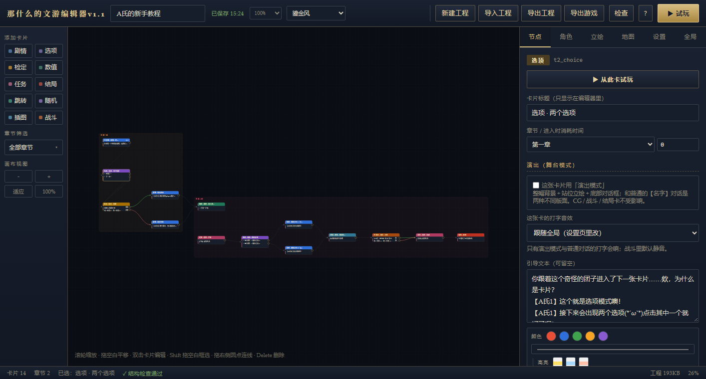

# 那什么的文游编辑器

> 一个开箱即用的**本地文字游戏编辑器 + 播放器**。零依赖、零安装、纯前端单文件，双击就能写、就能玩、就能导出。

[](#)　
[](#许可与免责)　
[](#)



## 这是什么

用**卡片 + 连线**的方式写文字游戏：剧情、选项、检定、数值、任务、结局、跳转、随机、插图、战斗，一共 10 种卡片。
写完点「▶ 试玩」立刻能玩，满意后「导出游戏」生成**一个可以单独发给别人的 HTML**（双击即玩，不依赖编辑器）。

- **完全离线**：不联网、不装环境，浏览器打开即可
- **单文件应用**：`那什么的文游编辑器.html`（`index.html` 内容相同，供 GitHub Pages 使用）
- **工程可带走**：导出 `story.json`，换电脑/换人继续编辑
- **成品可分发**：导出的 `.game.html` 自带引擎，对方双击就玩
- **适合同好**：无账号、无后端、无遥测

## 快速开始

1. 下载本仓库（或直接下载 `那什么的文游编辑器.html`）。
2. **双击 `那什么的文游编辑器.html`**（名字最直白的那个；`index.html` 是同一份内容）。
3. 想直接看成品：双击 `demo/雾港来信.game.html`（约 5 分钟，4 个结局）。
4. 第一次用？点右上角 `?` 看帮助，或「全局 → 载入新手教程」，里面有每种卡片和一次战斗演示。
5. 用不到的系统？「设置 → 功能开关」可以逐项关掉（立绘/背包/装备/任务/图鉴/地图/时间/角色创建）。
6. 界面太小？编辑器顶栏的百分比下拉、游玩页右上角「Aa」，75%–150% 随时调。
7. 换风格？游戏内 UI 在「设置 → 游玩页界面」点卡片（10 套）；编辑器自己的外观在顶栏「编辑外观」下拉，互不影响。

> 打开后默认载入新手教程；你的修改会自动保存在浏览器本地（右上角有保存状态）。
> 换电脑或清理浏览器缓存前，请用「导出工程」备份。

## 功能一览

| 模块 | 能做什么 |
|---|---|
| 卡片 | 剧情 / 选项 / 检定 / 数值 / 任务 / 结局 / 跳转 / 随机 / 插图 CG / 战斗，共 10 种 |
| 画布 | 拖拽、连线（或下拉选目标）、缩放、适应视图、复制、方向键微调、章节分区与多选筛选 |
| 条件与效果 | 属性 / 技能 / 货币 / 物品 / 任务；选项可隐藏或灰显并提示原因；自动校验支付能力 |
| 检定 | `1d20 + 加成 vs DC`，掷骰动画可关，成/败分支各连一张卡 |
| 战斗 | 单卡回合制：敌人血量/攻击/防御、玩家生命与攻防加成、攻击/防御、战斗日志、**可编辑的出招/受击反馈文字** |
| 角色 | 属性、技能、货币、物品、装备；开局角色创建（立绘、姓名、自定义设定、加点） |
| 装备 | 武器 / 护甲 / 饰品三个槽位，攻防加成叠加进战斗；玩家在背包里装备/卸下 |
| 对话 | 正文里写 `【名字】台词` 自动变对话框，匹配 NPC 立绘；10 套 UI 各自不同的对话样式 |
| 立绘 / CG | 上传图片自动压缩内嵌；CG 卡片整幅展示、点击放大；内置角色用名牌占位 |
| 地图 | 24×14 可调网格绘制（6 种图块、右键擦除、撤销、铺满），地点标注关联卡片；默认**只能前往到访过的地点**，不会跳过剧情 |
| 时间 | 每张卡可设消耗分钟数，跨天进位，状态栏显示「第X天 HH:MM」 |
| 存档 / 图鉴 | 3 个存档位、结局图鉴、自动保存、工程/成品两种导出 |
| 主题 | 10 套界面：机能 / 奶油 / 极简 / 鎏金 / 战术终端 / 月蓝学院 / 红黑叛逆 / 水墨古风 / 古典书信 / 蜡笔涂鸦；编辑页与游玩页分开选 |
| 系统开关 | 立绘 / 背包 / 装备 / 任务 / 图鉴 / 地图 / 时间 / 角色创建，逐项开关；全关只留角色和状态 |
| 界面缩放 | 编辑器顶栏百分比、游玩页右上角「Aa」，75%–150%，两边分别记忆，只影响本机 |
| 工具 | 结构检查（断头卡、缺分支、无效引用一键定位）、从此卡试玩（`Ctrl+Enter`）、帮助与快捷键 |

## 截图

| 编辑器 | 战斗 |
|---|---|
|  |  |

| 章节多选 | 插图 CG |
|---|---|
|  |  |

| 从某张卡开始调试 | 十套界面（节选） |
|---|---|
|  |  |

| 功能开关 | 背包与装备 |
|---|---|
|  |  |

| 地图前往规则 | 界面缩放 |
|---|---|
|  |  |

### 新增六套界面

| 战术终端风 | 月蓝学院风 |
|---|---|
|  |  |

| 红黑叛逆风 | 水墨古风 |
|---|---|
|  |  |

| 古典书信风 | 蜡笔涂鸦风 |
|---|---|
|  |  |

## 目录结构

```
那什么的文游编辑器/
├── 那什么的文游编辑器.html   ← 启动入口（双击这个；单文件应用）
├── index.html               ← 与上面内容相同，供 GitHub Pages 自动识别
├── README.md                ← 本文件
├── 交接文档.md               ← 完整开发/改版说明（强烈建议改版前读）
├── LICENSE                  ← 使用与改版许可
├── demo/
│   ├── 雾港来信.game.html    ← 可直接游玩的示例成品
│   └── 雾港来信.json         ← 示例工程（可导入编辑器）
├── screenshots/             ← 截图
├── css/style.css            ← 全部样式与十套主题
├── js/                      ← 数据层 / 导出器 / 画布 / 检查器 / 播放器 / 入口
├── index.template.html      ← 构建模板（DOM 骨架）
├── build.js                 ← 构建脚本
├── test/self-test.js        ← 无头自检（183 项）
└── tools/                   ← 命令行导出、截图工具
```

## 开发

源码不是启动 HTML，而是 `css/style.css` + `js/*.js` + `index.template.html`。改完运行：

```bash
node build.js
```

会生成 `那什么的文游编辑器.html`、`index.html` 和自检页 `test.html`。
`build.js` 会把 CSS/JS 内联进单文件应用（导出游戏功能依赖内联源码）。

自检（无头 Chrome，183 项，含教程/示例两条完整通关）：

```bash
chrome --headless=new --disable-gpu --user-data-dir=/tmp/nt \
  --virtual-time-budget=200000 --dump-dom "file:///<绝对路径>/test.html"
```

命令行导出游戏（不打开浏览器）：

```bash
node tools/export-game.js --story demo/雾港来信.json --out 我的游戏.html
```

## 导出与分发

- **导出工程**：得到 `story.json`，可再次导入继续编辑。
- **导出游戏**：得到单个 `.game.html`，内含引擎、故事和图片，对方双击即玩；
  顶栏的任务/角色/背包/地图/图鉴/存档全部可用。

## 兼容性与注意

- 推荐 Chrome / Edge / Firefox 近两年的版本（用到了 CSS `:is()`、可选链等现代特性）。
- 数据保存在浏览器 `localStorage`（约 5MB）：立绘、CG 多的时候注意体积，右上角会提示保存失败。
- 换电脑、换浏览器或清理缓存前，请先「导出工程」备份。
- 导出的游戏是纯静态 HTML，玩家存档同样保存在玩家自己的浏览器里。

## 许可与免责

本项目**完全免费开源，仅作同好分享使用**。

- 支持任何改版；改版请注明来源（**那什么的文游编辑器**）和修改人的联系方式。
- 不对编辑器产物做任何约束，也不承担任何责任。
- 使用本编辑器创作的游戏、剧本、美术等产物归创作者所有。

完整条款见 [LICENSE](LICENSE)。

## 关于作者

- 制作人：**ALLESI**
- 联系方式：**QQ 256085698**
- 版本：**1.0**

## 改版与 AI

本编辑器由 AI 辅助完成，完全支持改版制作：

- 启动 HTML 里的 CSS / JS 都是**未压缩**的，搜索 `NT_NODE_TYPES`、`Game`、`Inspector` 等关键字即可定位；
- 建议先读 [交接文档.md](交接文档.md)，里面有数据模型、模块职责、路径约定、构建与测试方法、每个设计取舍；
- **如果使用 AI 制作改版，请让 Agent 先阅读 `交接文档.md`**，再动手。
